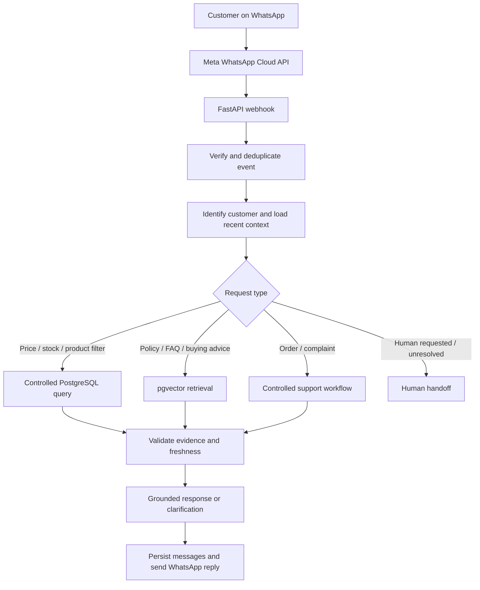

# NaijaMobile AI — WhatsApp Customer Service Agent

> **Portfolio/demo project.** NaijaMobile Hub is fictional. Product catalogue, prices, stock, policies, and example orders are synthetic demonstration data—not offers from a real retailer.

NaijaMobile AI is a WhatsApp customer-service assistant for a fictional Nigerian mobile-phone retailer. It is designed to answer product and policy questions using controlled database lookups and retrieval-augmented generation (RAG), while retaining conversation history and carefully selected customer preferences.

## Initial architecture



## Core design decisions

- **PostgreSQL is the source of truth** for product identity, prices, inventory, customer records, messages, and support tickets.
- **Price history is auditable.** A price change creates a history record. The language model never determines or invents a selling price.
- **Routine price changes do not require re-embedding.** Current prices and stock are queried from SQL; pgvector is for handbook, FAQ, and explanatory content.
- **RAG is not the database.** Use RAG for policy and descriptive answers; use controlled SQL tools for exact prices, stock, and order status.
- **Customer memory is selective.** Keep it separate from raw messages and support correction/deletion.
- **Never trust a customer-provided payment screenshot as proof of payment.** Only a trusted payment/inventory/order system can confirm it.
- **Human handoff must be truthful.** Do not say a human has been notified unless the handoff action actually succeeded.
- **Secrets belong in environment variables**, never in source control.

## Repository map

- `data/`: synthetic CSV inputs for products, prices, inventory, and example FAQs.
- `knowledge_base/`: Markdown documents intended for chunking and embedding.
- `sql/schema.sql`: PostgreSQL schema including pgvector and operational tables.
- `scripts/import_catalogue.py`: validated, transactional CSV import for products, prices, and inventory.
- `app/`: starter FastAPI app and controlled product-price service.
- `tests/`: starter unit tests.
- `docs/`: implementation plan, architecture, safety/privacy notes, and test plan.

## Quick start

This project targets **Python 3.11+** and PostgreSQL with the `vector` extension available.

1. Create a PostgreSQL database on a provider that supports pgvector.
2. Run `sql/schema.sql` against that database.
3. Create a virtual environment and install dependencies:

   ```bash
   python -m venv .venv
   # Windows PowerShell:
   .venv\Scripts\Activate.ps1
   # macOS/Linux:
   # source .venv/bin/activate
   pip install -r requirements.txt
   ```

4. Copy `.env.example` to `.env` and fill in real credentials locally or in your host's environment settings.
5. Import the synthetic catalogue:

   ```bash
   python scripts/import_catalogue.py --products data/products.csv --prices data/product_prices.csv --inventory data/inventory.csv
   ```

6. Start the API:

   ```bash
   uvicorn app.main:app --reload
   ```

7. Visit `/health` to check the service.

> The starter webhook currently verifies Meta's webhook challenge and exposes a health endpoint. Sending and receiving real WhatsApp messages, authentication/signature verification, RAG ingestion, hosted LLM calls, admin authorization, and production observability are staged implementation tasks—not falsely claimed as complete.

## Catalogue and price-update rules

- `products.csv` contains stable product identity and descriptive attributes.
- `product_prices.csv` contains the current demo price and the last price-update timestamp.
- `inventory.csv` contains the demo stock count and inventory timestamp.
- `product_price_history` records every imported price change after the first price is established.
- The importer rejects duplicate SKUs, unknown SKUs, invalid prices, and malformed data. It uses a transaction so invalid input does not partially update the catalogue.
- Price freshness is currently configured to **7 days** in `app/services/pricing.py`. This is a demo business rule, not a legal requirement.
- A stale price must not be presented as verified/current. The agent should explain that it needs confirmation.
- All data in this initial catalogue is synthetic. Do not represent it as a real shop's inventory or current market pricing.

## Environment variables

See `.env.example`. Never commit `.env`, API tokens, access tokens, database passwords, or customer data.

## Roadmap

1. **Foundation:** schema, synthetic CSVs, validated import, price freshness and history.
2. **Customer-service core:** customer/conversation/message persistence, webhook deduplication, outbound WhatsApp integration.
3. **RAG:** document ingestion, chunking, embeddings, pgvector retrieval, source metadata.
4. **Agent workflow:** intent routing, controlled tools, grounded response generation, escalation.
5. **Admin controls:** authorized catalogue updates, price audit view, stock updates, policy approval.
6. **Evaluation and deployment:** automated tests, prompt-injection tests, latency/error monitoring, hosted deployment.

## License

Choose a license before publishing. Synthetic demo content is provided for project development; verify third-party model, package, and platform licenses before commercial use.
